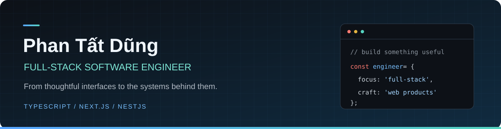

  

  <a href="#-about">About</a> &nbsp; · &nbsp;
  <a href="#-tech-stack">Tech Stack</a> &nbsp; · &nbsp;
  <a href="#-selected-projects">Projects</a> &nbsp; · &nbsp;
  <a href="#-github-activity">GitHub Activity</a>

## 👋 About

I'm **Phan Tất Dũng**, a full-stack software engineer building web applications with **NestJS, Next.js, and TypeScript**. I enjoy connecting clear, usable interfaces with the data and application logic that make them work.

My public projects explore practical problems: planning university timetables, navigating city transit, and ordering food online.

## 🛠 Tech Stack

<table>
<tr>
<td width="150"><strong>Frontend</strong></td>
<td>

</td>
</tr>
<tr>
<td><strong>Backend &amp; Data</strong></td>
<td>

</td>
</tr>
<tr>
<td><strong>Languages &amp; Libraries</strong></td>
<td>

</td>
</tr>
</table>

## 🚀 Selected Projects

<table>
<tr>
<td width="50%" valign="top">
<h3>📅 UIT Schedule Planner</h3>

A course planning tool for UIT students, from importing class data to finding a timetable that fits.

<ul>
<li>Excel and Google Sheets imports</li>
<li>Conflict detection and automatic schedule combinations</li>
<li>Multiple plans and timetable image export</li>
</ul>

<code>Next.js</code> <code>TypeScript</code> <code>Zustand</code>

<a href="https://github.com/phantatdung233/dkhp-uit"><strong>Explore repository →</strong></a>
</td>
<td width="50%" valign="top">
<h3>🚌 HCMC Bus Map</h3>

An interactive transit app for exploring bus routes and stops across Ho Chi Minh City.

<ul>
<li>Interactive maps and route details</li>
<li>Bus arrival estimates</li>
<li>Digital tickets and wallet flows</li>
</ul>

<code>Next.js</code> <code>MongoDB</code> <code>Leaflet</code>

<a href="https://github.com/phantatdung233/hcmc-bus-map"><strong>Explore repository →</strong></a>
</td>
</tr>
<tr>
<td colspan="2" valign="top">
<h3>🍽 WDS Food Delivery</h3>

A food ordering frontend covering restaurant discovery, menus, a persistent cart, and a validated checkout flow with mock API data.

<code>Next.js</code> <code>TypeScript</code> <code>Tailwind CSS</code> <code>shadcn/ui</code> <code>Zustand</code>

<a href="https://github.com/phantatdung233/wds-food-delivery"><strong>Explore repository →</strong></a>
</td>
</tr>
</table>

## 📊 GitHub Activity

  

  
  

Public GitHub activity · Cards refresh through GitHub Profile Summary Cards

---

  <strong>Thanks for stopping by.</strong> 
  Explore the repositories to see what I'm building.

