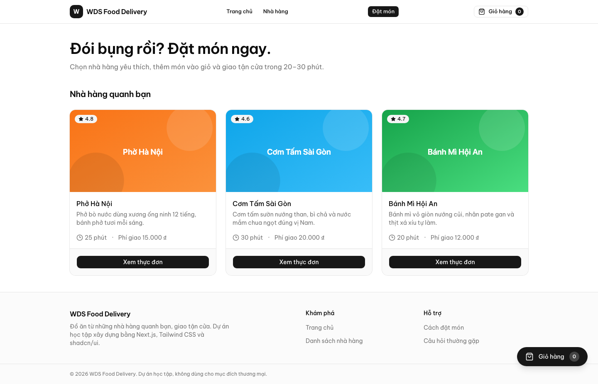

I'm **Dũng**, a software engineer working across the frontend and backend with **Next.js, NestJS, and TypeScript**. My public projects explore course planning, city transit, and food ordering.

[Selected projects](#selected-projects) &nbsp; / &nbsp; [Tech stack](#tech-stack) &nbsp; / &nbsp; [GitHub activity](#github-activity)

## Selected projects

<table>
<tr>
<td width="50%" valign="top">
<h3><a href="https://github.com/phantatdung233/dkhp-uit">UIT Schedule Planner</a></h3>

Helping UIT students turn course data into a timetable that fits.

<ul>
<li>Import classes from Excel or Google Sheets.</li>
<li>Detect overlaps and generate compatible course combinations.</li>
<li>Keep multiple plans and export a timetable image.</li>
</ul>

<code>Next.js</code> <code>TypeScript</code> <code>Zustand</code>

</td>
<td width="50%" valign="top">
<h3><a href="https://github.com/phantatdung233/hcmc-bus-map">HCMC Bus Map</a></h3>

Exploring Ho Chi Minh City transit through an interactive map.

<ul>
<li>Browse routes, stops, fares, and operating hours.</li>
<li>Look up arrival estimates between stops.</li>
<li>Explore digital ticket and wallet workflows.</li>
</ul>

<code>Next.js</code> <code>MongoDB</code> <code>Leaflet</code>

</td>
</tr>
</table>

### [WDS Food Delivery](https://github.com/phantatdung233/wds-food-delivery)

A food ordering frontend with restaurant menus, a persistent cart, and a validated checkout flow. Built with mock API data as a learning project.

`Next.js` `TypeScript` `Tailwind CSS` `shadcn/ui` `Zustand`

Homepage preview from the project repository.

## Tech stack

| Area | Technologies |
| :--- | :--- |
| Frontend | Next.js, React, Tailwind CSS, shadcn/ui |
| Backend & data | NestJS, MongoDB |
| Languages | TypeScript, JavaScript |
| State & interactions | Zustand, React Hook Form, Zod, Leaflet |

## GitHub activity

<picture>
  <source media="(prefers-color-scheme: dark)" srcset="https://github-profile-summary-cards.vercel.app/api/cards/profile-details?username=phantatdung233&amp;theme=github_dark" />
  
</picture>

<picture>
  <source media="(prefers-color-scheme: dark)" srcset="https://github-profile-summary-cards.vercel.app/api/cards/stats?username=phantatdung233&amp;theme=github_dark" />
  
</picture>
<picture>
  <source media="(prefers-color-scheme: dark)" srcset="https://github-profile-summary-cards.vercel.app/api/cards/repos-per-language?username=phantatdung233&amp;theme=github_dark" />
  
</picture>

Public activity, rendered by <a href="https://github.com/vn7n24fzkq/github-profile-summary-cards">GitHub Profile Summary Cards</a>. Language counts describe repositories, not proficiency.
