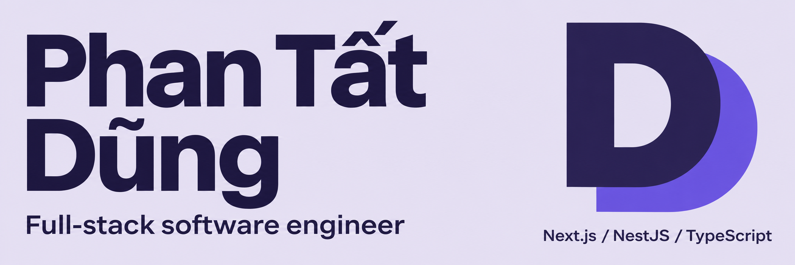

  <a href="#-about">About</a> &nbsp; · &nbsp;
  <a href="#-tech-stack">Tech Stack</a> &nbsp; · &nbsp;
  <a href="#-github-activity">GitHub Activity</a>

## 👋 About

I'm **Phan Tất Dũng**, a full-stack software engineer building web applications with **NestJS, Next.js, and TypeScript**. I enjoy connecting clear, usable interfaces with the data and application logic that make them work.

## 🛠 Tech Stack

<table>
<tr>
<td width="150"><strong>Frontend</strong></td>
<td>

</td>
</tr>
<tr>
<td><strong>Backend &amp; Data</strong></td>
<td>

</td>
</tr>
<tr>
<td><strong>Languages &amp; Libraries</strong></td>
<td>

</td>
</tr>
</table>

## 📊 GitHub Activity

  
  

  <picture>
    <source media="(prefers-color-scheme: dark)" srcset="https://raw.githubusercontent.com/phantatdung233/phantatdung233/output/github-contribution-grid-snake-dark.svg" />
    
  </picture>

Public GitHub activity · Cards from GitHub Profile Summary Cards · Snake from Platane/snk

---

  <strong>Thanks for stopping by.</strong> 
  Explore the repositories to see what I'm building.

